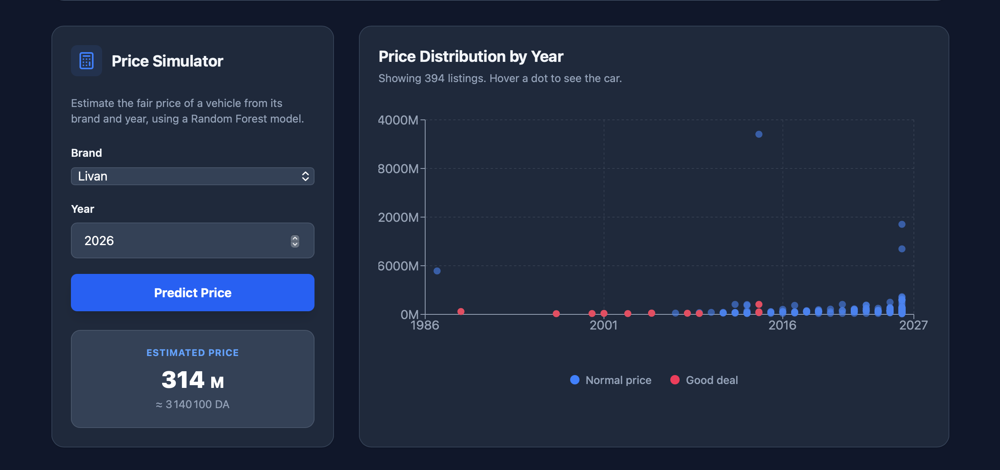
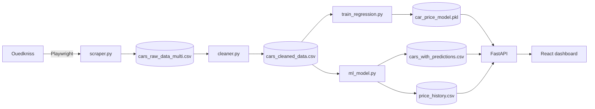

# 🚙 DzAuto-Radar

**Automated car market pipeline and AI dashboard for the Algerian market.**




## 📌 Overview

DzAuto-Radar scrapes car listings from [Ouedkniss](https://www.ouedkniss.com), cleans them, estimates a **fair market price** for every car with machine learning, and highlights the listings that are **significantly cheaper than they should be** ("good deals"). Everything runs in Docker with a single command and is explored through a modern React dashboard.

## ✨ Features

- 🕸️ **Asynchronous scraping** with Playwright (lazy loading, random delays, anti-bot failure handling).
- 🧹 **Robust cleaning**: price parsing (millions / milliards / dinars), year extraction, brand normalization, deduplication.
- 🤖 **Fair price prediction** with a Random Forest regressor (brand + year), evaluated on a hold-out set (MAE and R²).
- 🔥 **Good deal detection**: each car is priced by a cross-validated model that never saw it. An Isolation Forest then flags the statistical outliers that are also **below** their fair price.
- 📈 **Market trend**: the average price is stored daily to follow the market over time.
- ⚡ **FastAPI backend** with automatic Swagger docs and hot-reloaded data (no restart after a new pipeline run).
- 🎨 **React dashboard**: KPI cards, trend chart, price simulator, interactive scatter chart, searchable and paginated deals table, animated with Motion, dark mode included.
- 🐳 **Fully containerized** with Docker Compose.

## 🏗️ Architecture



## 📂 Project Structure

```text
DzAuto-Radar
 ┣ backend
 ┃ ┣ api.py                # FastAPI app
 ┃ ┣ config.py             # All file paths in one place
 ┃ ┣ utils.py              # Brand normalization helpers
 ┃ ┣ scraper.py            # Playwright scraper
 ┃ ┣ cleaner.py            # Raw data -> clean data
 ┃ ┣ train_regression.py   # Fair price model (Random Forest)
 ┃ ┣ ml_model.py           # Good deal detection + price history
 ┃ ┣ run_all.py            # Runs the full pipeline
 ┃ ┣ requirements.txt
 ┃ ┗ Dockerfile
 ┣ frontend
 ┃ ┣ src
 ┃ ┃ ┣ components          # Dashboard UI blocks
 ┃ ┃ ┣ hooks               # Data fetching and theme logic
 ┃ ┃ ┗ lib                 # API client, formatters, chart theme
 ┃ ┗ Dockerfile
 ┣ data                    # Generated CSV files (git-ignored)
 ┣ models                  # Trained model (git-ignored)
 ┗ docker-compose.yml
```

## 🚀 Quick Start (Docker)

**Requirements:** [Docker Desktop](https://www.docker.com/products/docker-desktop/)

```bash
# 1. Clone the repository
git clone https://github.com/Djilali-77/DzAuto-radar.git
cd car-market-pipeline

# 2. Build and start the containers
docker compose up --build -d

# 3. Run the full pipeline (scrape, clean, train, detect good deals)
docker compose exec backend python run_all.py
```

The scraping step takes a few minutes. To skip it and reuse an existing `data/cars_raw_data_multi.csv`:

```bash
docker compose exec backend python run_all.py --skip-scrape
```

Then open:

| Service | URL |
|---|---|
| Dashboard | http://localhost:5173 |
| API docs (Swagger) | http://localhost:8000/docs |

> Before the first pipeline run the dashboard shows an error, which is expected. Click the refresh button once the pipeline is done.

## 💻 Run Locally (without Docker)

**Backend** (Python 3.10 to 3.12):

```bash
cd backend
python3 -m venv .venv
source .venv/bin/activate
pip install -r requirements.txt
playwright install chromium
python run_all.py
uvicorn api:app --reload
```

**Frontend** (Node 20.19+ or 22+):

```bash
cd frontend
cp .env.example .env
npm install
npm run dev
```

Locally, data and models are written to `data/` and `models/` at the project root.

## ⚙️ The Pipeline

| Step | Script | Output |
|---|---|---|
| 1. Scrape | `scraper.py` | `data/cars_raw_data_multi.csv` |
| 2. Clean | `cleaner.py` | `data/cars_cleaned_data.csv` |
| 3. Train | `train_regression.py` | `models/car_price_model.pkl` |
| 4. Detect deals | `ml_model.py` | `data/cars_with_predictions.csv`, `data/price_history.csv` |

You can also run any step on its own, for example `docker compose exec backend python cleaner.py`.

> **Price unit:** prices are expressed in "millions", the way Algerians quote them (1 million = 10,000 DA).

## 📡 API Endpoints

| Endpoint | Description |
|---|---|
| `GET /api/cars?limit=50` | Cleaned car records with fair price and discount (limit 1 to 500) |
| `GET /api/stats` | Total listings, number of good deals, average price |
| `GET /api/anomalies` | Good deals, sorted by biggest discount |
| `GET /api/brands` | Brands known by the model |
| `GET /api/predict?brand=Geely&year=2026` | Fair price estimate (the brand must exist in `/api/brands`) |
| `GET /api/history` | Daily average market price |
| `GET /ping` | Health check |

## 🛠️ Tech Stack

- **Backend:** Python, FastAPI, Uvicorn
- **Data and ML:** Pandas, Scikit-Learn (Random Forest, Isolation Forest), Joblib
- **Scraping:** Playwright (Chromium)
- **Frontend:** React, Vite, Tailwind CSS v4, Motion, Recharts, Lucide
- **DevOps:** Docker, Docker Compose

## ⚠️ Known Limitations

- The model only uses **brand and year**. Mileage, model, fuel type and region are not scraped yet, so the fair price is an approximation.
- The result depends on how many listings are scraped and on Ouedkniss not blocking the scraper.
- The fair price of a brand with very few listings can be unreliable.


## 📜 Disclaimer

This project is for **educational purposes**. Respect the terms of service of the websites you scrape, keep the delays between requests, and do not redistribute scraped data. Price estimates are indicative and are not financial advice.

## 👤 Author

**Djilali**: [@Djilali-77](https://github.com/Djilali-77)
